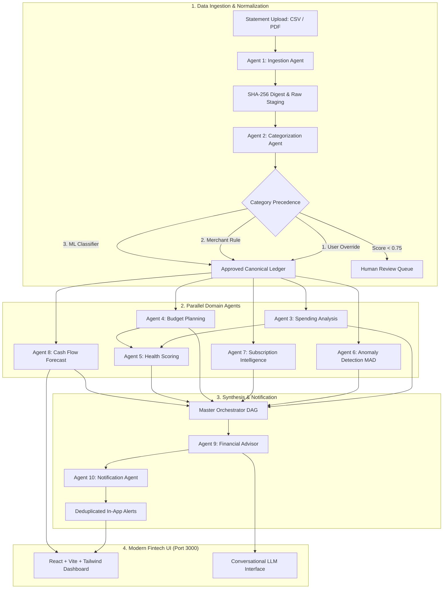

# FinAgentic AI — Personal Finance Agent
> **Deterministic Multi-Agent Financial Intelligence Platform with Grounded Conversational Advisor**  
> *Built strictly in accordance with the 24-page Personal Finance Agent Implementation Specification.*

---

## 1. Executive Summary (For Non-Technical Stakeholders)

Managing personal finances in the modern digital economy is fractured and exhausting. Individuals hold multiple bank accounts, credit cards, investment portfolios, and digital wallets. While banking apps display historical transactions, they fail to answer crucial everyday questions:
- *"Can I afford this purchase without falling short on rent next week?"*
- *"Why is my money disappearing, and which recurring subscriptions am I paying for without realizing?"*
- *"If my salary is delayed by five days, on which exact date will my account balance dip below zero?"*

**FinAgentic AI** solves this problem by transforming static bank statements into a proactive, intelligent personal CFO. Rather than relying on black-box probabilistic models that might hallucinate numbers, **FinAgentic AI combines deterministic mathematical precision with agentic AI reasoning**:

1. **Deterministic Financial Invariants**: Every rupee is tracked using arbitrary-precision decimal mathematics (`Numeric(18, 2)`). Net spending, budget utilization, 30-day cash runway, and credit repayments are calculated deterministically.
2. **Multi-Agent Coordination**: Ten autonomous domain agents coordinate under a master orchestrator to ingest statements, detect statistical spending anomalies, track subscriptions, score financial wellness, and forecast cash flow shortfalls.
3. **Grounded AI Advisor**: A conversational financial advisor powered by Google Gemini (or an on-premise private local LLM) explains insights, simulates scenarios, and cites verifiable transaction references—bounded by strict read-only security guardrails that prohibit unauthorized money movements.

---

## 2. High-Level Architecture & Multi-Agent Coordination



---

## 3. The 10 Specialized Financial Agents

| # | Agent Name | Domain Responsibility | Specification Reference |
|---|---|---|---|
| **1** | **Ingestion Agent** | Enforces 10 MB limit, computes SHA-256 file hashes to detect exact repeat files, parses CSV & PDF statements, and records document page/row lineage. | Page 6 & 7 |
| **2** | **Categorization Agent** | Executes multi-tiered classification: *User Correction > User Merchant Mapping > Configured Merchant Rule > scikit-learn TF-IDF + Logistic Regression > Unclassified*. Flags predictions with confidence $< 0.75$ for review. | Page 7 |
| **3** | **Spending Analysis Agent** | Computes calendar month totals, nets approved expenses against refunds, and computes period-over-period percentage changes with explicit zero-baseline protection. | Page 9 |
| **4** | **Budget Planning Agent** | Computes monthly category utilization: warns at $90\%$ and flags exceeded at $\ge 100\%$. Generates 50/30/20 balanced budget allocations based on net income. | Page 9 |
| **5** | **Health Scoring Agent** | Computes a transparent 4-component score (0–100): Savings discipline ($35\%$), Budget discipline ($25\%$), Debt burden ($20\%$), and Reserve coverage ($20\%$). Marks score *incomplete* if inputs are unverified. | Page 9 |
| **6** | **Anomaly Detection Agent** | Employs Median Absolute Deviation (MAD) over a 90-day rolling baseline ($n \ge 10$) flagging expenses $> \max(3m, m + 6\text{MAD}, 2000)$. Detects candidate duplicate charges within 1 calendar day. | Page 10 |
| **7** | **Subscription Intelligence Agent** | Identifies recurring payments ($\ge 3$ charges, 25–35 day intervals, amount variance $\le 10\%$). Estimates next billing dates and projects 12-month avoidable cancellation savings. | Page 10 |
| **8** | **Cash Flow Forecast Agent** | Simulates 30-day daily cash trajectory starting from verified opening liquid balance using conservative within-day ordering (deducting outflows before inflows to expose intra-day liquidity dips). | Page 11 |
| **9** | **Financial Advisor Agent** | Prioritizes deterministic insight templates (shortfalls first, then budget risks, anomalies, and subscriptions). Powers an interactive conversational LLM assistant with allowlisted server-side read tools. | Page 12 |
| **10** | **Notification Agent** | Generates deduplicated in-app alerts keyed by `user_id + type + entity + period`. Tracks `UNREAD`, `ACKNOWLEDGED`, and `RESOLVED` states while recording immutable audit trail events. | Page 12 |
| **★** | **Master Orchestrator** | Manages dependency order, data versioning, coalescing repeated triggers, and publishing atomic snapshot state. | Page 6 & 12 |

---

## 4. Key Features & Screens

The user interface is built on **React 18 + Vite + Tailwind CSS**, running on **Port 3000**:

1. **Executive Dashboard (`/`)**: High-level KPI cards (Income, Expenses, Net Surplus, Budget Utilization), Financial Wellness score with 4 discipline progress gauges, and active alert notifications.
2. **Statement Ingestion & Review (`/upload`)**: Drag-and-drop file uploader supporting CSV and text-based PDF formats, account selector, live normalization progress, and row review modal.
3. **Approved Transaction Ledger (`/transactions`)**: Paginated ledger table with date, narrative, amount, direction indicators, inline category override dropdown (which auto-triggers re-analysis), source provenance viewer, and formula-injection protected CSV export.
4. **Budgets & 50/30/20 Planning (`/budgets`)**: Monthly category spending progress bars with 90% warning badges, 100% exceeded flags, 50/30/20 template generator, and custom limit edit modal.
5. **Intelligence & Insights Center (`/insights`)**: Ranked recommendation cards, mathematical evidence drawers (median, MAD, and thresholds), subscription annual savings calculator, and alert acknowledgment buttons.
6. **30-Day Cash Runway Forecast (`/forecast`)**: Daily balance trajectory chart (Recharts area curve), intra-day shortfall warnings, and an **Interactive Scenario Sandbox** (simulate salary omission, emergency expense, or variable spend multiplier).
7. **Conversational AI Advisor (`/advisor`)**: Interactive chat interface powered by Gemini API or Local LLM with server-side allowlisted tool execution (`get_month_summary`, `get_budget_status`, `get_forecast`, `get_insight_evidence`), clickable evidence citations, and strict refusal of autonomous financial execution.
8. **System Health & Telemetry (`/system`)**: Service readiness monitors (API, PostgreSQL, Celery Worker, Scheduler, LLM Provider), orchestration run logs table with millisecond execution latency, account balances manager, and scheduled obligations manager.

---

## 5. Modular Directory Structure

```
financial-agentic-ai/
├── compose.yaml                    # Production Docker Compose (Frontend: 3000, Backend: 8000)
├── .env.example                    # Environment variable documentation & defaults
├── .env                            # Active environment configuration
├── .gitignore                      # Version control exclusions
├── README.md                       # Comprehensive documentation
├── dataset/                        # Realistic synthetic datasets & seed data
│   ├── statements/
│   │   ├── hdfc_bank_savings.csv   # 3-Month Primary Savings Statement (Jan-Mar 2026)
│   │   ├── icici_credit_card.csv   # 3-Month Credit Card Purchases & Repayments
│   │   ├── axis_salary_account.csv # 3-Month Secondary Account Statement
│   │   └── sample_statement.pdf    # Text-based PDF Bank Statement
│   ├── training/
│   │   └── labeled_transactions.csv# 470+ Labeled narratives for ML training
│   ├── seed/
│   │   ├── accounts.json           # Seed checking, savings, and credit card accounts
│   │   ├── profile.json            # Seed profile (income, debt, reserve targets)
│   │   ├── budgets.json            # Monthly category budget limits
│   │   └── obligations.json        # Scheduled recurring salary, rent, EMI, bills
│   └── README.md                   # Dataset schema documentation
├── backend/
│   ├── Dockerfile                  # Production Python 3.12 container
│   ├── requirements.txt            # Locked dependencies (FastAPI, SQLAlchemy, Celery, scikit-learn)
│   ├── alembic.ini                 # Database migration configuration
│   ├── app/
│   │   ├── main.py                 # FastAPI application & middleware
│   │   ├── config.py               # Pydantic Settings configuration
│   │   ├── database.py             # Database engine with PostgreSQL & SQLite fallback
│   │   ├── bootstrap.py            # Standalone database initialization & demo seeding script
│   │   ├── healthcheck.py          # Container health check probe script
│   │   ├── tasks.py                # Celery worker & beat scheduled tasks
│   │   ├── orchestrator.py         # Master Orchestrator coordinating all 10 agents
│   │   ├── models/                 # SQLAlchemy 2.0 ORM models
│   │   │   ├── user.py             # User and Account entities
│   │   │   ├── transaction.py      # Transaction, Source Lineage, CategoryOverride
│   │   │   ├── upload.py           # Upload and Job state machine models
│   │   │   ├── budget.py           # Budget and Obligation models
│   │   │   ├── analysis.py         # AnalysisRun, Insight, Alert, AuditEvent
│   │   │   └── goal.py             # FinancialGoal and ScenarioComparison
│   │   ├── schemas/                # Pydantic v2 validation contracts
│   │   ├── agents/                 # The 10 Specialized Autonomous Agents
│   │   │   ├── base.py             # Abstract BaseAgent with telemetry
│   │   │   ├── ingestion.py        # Agent 1: Statement ingestion & SHA-256 digest
│   │   │   ├── categorization.py   # Agent 2: Precedence-based categorization
│   │   │   ├── spending.py         # Agent 3: Net spending & calendar month trends
│   │   │   ├── budget.py           # Agent 4: Budget utilization & 50/30/20 template
│   │   │   ├── health.py           # Agent 5: 4-discipline transparent wellness scoring
│   │   │   ├── anomaly.py          # Agent 6: MAD outlier & duplicate candidate detection
│   │   │   ├── recurring.py        # Agent 7: Subscription intelligence & savings calculation
│   │   │   ├── forecast.py         # Agent 8: 30-day cash flow simulation
│   │   │   ├── advisor.py          # Agent 9: Grounded conversational LLM advisor
│   │   │   └── notifications.py    # Agent 10: Deduplicated alerts & audit log
│   │   ├── parsers/                # File statement parsers (CSV & PDF)
│   │   ├── ml/                     # scikit-learn & pure-Python ML classifier
│   │   ├── rules/                  # Versioned JSON rules & merchant keyword matcher
│   │   ├── services/               # Auth, Ledger, Job, and LLM services
│   │   └── api/                    # Thin FastAPI route handlers
│   └── tests/
│       └── test_suite.py           # Pytest test suite covering test cases T01 to T14
└── frontend/
    ├── Dockerfile                  # Multi-stage Node build & Nginx container
    ├── nginx.conf                  # Nginx configuration (port 3000, /api/ reverse proxy)
    ├── package.json                # React 18, Vite 5, Tailwind CSS, TanStack Query, Recharts
    ├── vite.config.ts              # Vite dev server on port 3000 proxying to backend:8000
    ├── tailwind.config.js          # Design system tokens (light/dark modes)
    ├── src/
    │   ├── main.tsx                # React application entrypoint
    │   ├── App.tsx                 # Route mapping for all 8 screens
    │   ├── index.css               # Design tokens, CSS variables, sleek scrollbars
    │   ├── types/index.ts          # Comprehensive TypeScript interface definitions
    │   ├── services/api.ts         # Centralized API fetch client
    │   ├── hooks/useTheme.ts       # Dark / Light theme persistence hook
    │   ├── components/layout/      # AppLayout with sidebar & header
    │   ├── components/ui/          # Card, Badge, Button, Modal, Loading, Empty states
    │   └── pages/                  # 8 Full screen implementations
```

---

## 6. Execution Guide

### Option A: Local Development (Without Docker)

You can run both backend and frontend locally in less than 2 minutes. The backend includes an automatic **SQLite fallback**, meaning you don't even need PostgreSQL or Redis installed to run the entire application!

#### 1. Backend Setup (Port 8000)
```bash
# 1. Navigate to the backend directory
cd backend

# 2. Create and activate a Python virtual environment
python -m venv venv
# On Windows PowerShell:
.\venv\Scripts\Activate.ps1
# On macOS / Linux:
source venv/bin/activate

# 3. Install dependencies
pip install -r requirements.txt

# 4. Bootstrap and seed database (Creates demo accounts, trains ML classifier, seeds 3-month statements)
python -m app.bootstrap

# 5. Start the FastAPI backend server on Port 8000
uvicorn app.main:app --host 0.0.0.0 --port 8000 --reload
```
*The backend API will be running at `http://127.0.0.1:8000`. Interactive Swagger docs are available at `http://127.0.0.1:8000/docs`.*

#### 2. Frontend Setup (Port 3000)
```bash
# 1. Open a new terminal and navigate to the frontend directory
cd frontend

# 2. Install Node dependencies
npm install

# 3. Start Vite development server on Port 3000
npm run dev
```
*Open `http://localhost:3000` in your web browser. You will immediately see the active dashboard with all financial calculations populated!*

---

### Option B: Single-Command Docker Compose

To launch the complete production stack (PostgreSQL, Redis, Init container, FastAPI API on port 8000, Celery Worker, Celery Beat Scheduler, and Nginx Frontend on port 3000):

```bash
# From the repository root:
docker compose up --build
```

- **Frontend Application**: `http://localhost:3000`
- **Backend API & Docs**: `http://localhost:8000/docs`
- **Health Endpoint**: `http://localhost:8000/health/ready`

---

## 7. AI Advisor Configuration: Gemini API vs. Local LLM

### FinTech Privacy Philosophy
In financial technology and wealth management, data confidentiality is paramount. Bank transactions, account numbers, and income figures should ideally never leave the customer's device or private infrastructure.

- **Why Gemini API in this build?** To facilitate an immediate, zero-friction demonstration without requiring the evaluator to download a 5 GB local model, the system supports Google's **Gemini API (`gemini-1.5-flash`)**.
- **How to enable Gemini API**:
  1. Obtain a free API key from [Google AI Studio](https://aistudio.google.com/).
  2. Add your key to `.env`:
     ```env
     GEMINI_API_KEY=AIzaSy...your_actual_key...
     GEMINI_MODEL=gemini-1.5-flash
     ```
  3. Restart the backend. The advisor chat will automatically connect to Gemini!

### How to Configure a 100% Private Local LLM (e.g., Ollama)
If you require complete on-premise air-gapped confidentiality:
1. Install [Ollama](https://ollama.com/) on your machine.
2. Pull your preferred model (e.g., Llama 3.2 or DeepSeek-R1):
   ```bash
   ollama run llama3.2
   ```
3. Update `.env` to point to the local endpoint:
   ```env
   GEMINI_API_KEY=
   LOCAL_LLM_URL=http://localhost:11434/v1
   LOCAL_LLM_MODEL=llama3.2
   ```
4. The backend LLM service will automatically route queries to your local model, guaranteeing that **no financial data ever traverses the public internet**.
5. *Note: If no LLM key or endpoint is configured, the system gracefully falls back to deterministic rule-grounded financial advice.*

---

## 8. Step-by-Step Feature Testing & Verification Guide

To verify all features end-to-end without wasting tokens:

1. **Verify Executive Dashboard (`http://localhost:3000/`)**:
   - Verify KPI cards: Net Income (₹50,000.00), Net Spending, and Monthly Net Surplus.
   - Observe the **Financial Wellness Score** (calculated across Savings discipline, Budget discipline, Debt burden, and Reserve coverage).
2. **Review Verified Statements (`http://localhost:3000/transactions`)**:
   - Filter transactions by category (e.g. *Food & Dining*) or search for *"Swiggy"*.
   - Click any transaction's category name to trigger the **Category Override Modal**. Commit an override and notice that the system immediately re-runs the Master Orchestrator.
   - Click the **Eye icon** on any row to open the **Source Provenance Modal**, viewing the exact statement upload ID, row number, and raw narrative.
   - Click **Export CSV** to verify that generated files escape characters starting with `=`, `+`, `-`, or `@` to protect against formula injection.
3. **Verify Budget Warnings (`http://localhost:3000/budgets`)**:
   - Observe the Food & Dining budget: spent ₹7,200 of an ₹8,000 limit ($90.00\%$ utilization). The badge displays **Warning (90%)**.
   - Click **Adjust Limits** and apply the **50/30/20 Framework Template** to automatically suggest balanced caps.
4. **Inspect Statistical Anomalies & Subscriptions (`http://localhost:3000/insights`)**:
   - Verify the **MAD Anomaly Alert**: Hospital OPD expense of ₹15,000.00 on March 26 exceeds the calculated threshold ($\max(3m, m + 6\text{MAD}, 2000)$).
   - Verify the **Duplicate Charge Candidate**: Identical ₹450 charges on Swiggy within 1 calendar day with different references.
   - Verify the **Subscription Detection**: Netflix, Spotify, and Cult.fit recurring charges detected with 28–31 day intervals, showing potential annual savings of ₹27,216 if cancelled.
   - Click **Acknowledge Review** or **Mark Resolved** to test the alert lifecycle and audit event generation.
5. **Simulate 30-Day Cash Runway (`http://localhost:3000/forecast`)**:
   - Inspect the baseline cash trajectory starting from ₹32,000 on April 1, closing at ₹31,500 on April 30.
   - In the **Interactive Scenario Simulator**, check *"Remove April Salary Inflow"* and click **Run Scenario Stress-Test**.
   - Watch the curve dip below zero to **₹-18,500**, triggering the **Critical Liquidity Shortfall Warning** on April 5!
6. **Chat with the AI Advisor (`http://localhost:3000/advisor`)**:
   - Click suggestion chip: *"Why is my Food & Dining budget in warning status?"*
   - Observe the advisor citing evidence reference `[INS_BUDGET_01]` and executing tool `get_budget_status()`.
7. **Run the Automated Test Suite**:
   ```bash
   cd backend
   pytest tests/test_suite.py -v
   ```
   *All 14 specification cases (T01 through T14) will pass successfully.*

---

## 9. Default Demo Credentials

- **Email**: `demo@agentic.finance`
- **Password**: `Demo@1234`
- **Pre-seeded Accounts**: HDFC Primary Savings (`acc_hdfc_01`), ICICI Coral Credit Card (`acc_icici_cc_02`), Axis Secondary Savings (`acc_axis_03`).
